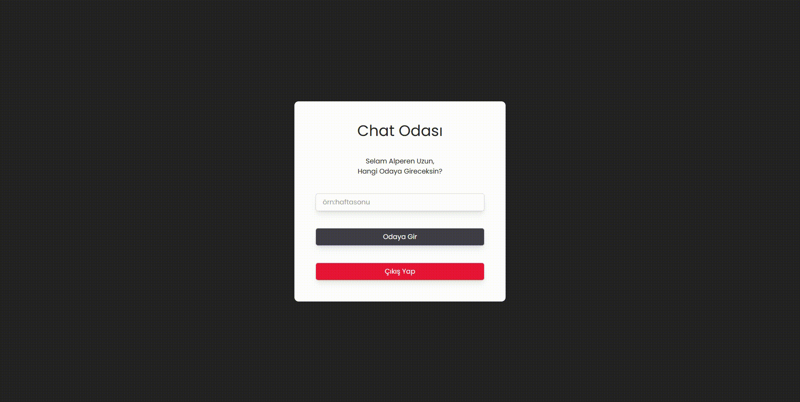

💬 React Firebase Chat App

Bu proje, React ve Firebase kullanılarak geliştirilmiş gerçek zamanlı bir sohbet (chat) uygulamasıdır.
Kullanıcılar Google ile giriş yaparak sohbet odalarına katılabilir, mesaj gönderebilir ve gerçek zamanlı konuşma gerçekleştirebilirler.

🖼️ Ekran Görüntüsü

🚀 Özellikler

🔐 Google Authentication (Firebase Auth) ile giriş

💬 Gerçek zamanlı mesajlaşma (Firebase Firestore)

🏠 Sohbet odaları (room bazlı yapı)

👤 Kullanıcı kimlik doğrulama koruması (Protected Routes)

⚡ Vite ile hızlı geliştirme ortamı

🎨 Modern ve sade kullanıcı arayüzü (Tailwind / CSS)

🧩 Kullanılan Teknolojiler

⚛️ React-UI bileşenleri

🔥 Firebase-Authentication & Firestore

🧭 React Router DOM-Sayfa yönlendirme

⚡ Vite-Hızlı geliştirme ortamı

💅 CSS / Tailwind-Stil yönetimi

📦 Kurulum

Projeyi kendi bilgisayarında çalıştırmak için aşağıdaki adımları izle:

# Depoyu klonla

git clone https://github.com/ualperen41/Chat

# Proje klasörüne gir

cd firebase-chat

# Bağımlılıkları yükle

npm install

# Geliştirme sunucusunu başlat

npm run dev

🧠 Öğrenilenler

Bu projeyi geliştirirken şunları öğrendim:

Firebase Authentication ile kullanıcı girişi

Firestore kullanarak gerçek zamanlı veri yönetimi

React Router DOM ile korumalı sayfalar (Protected Routes) oluşturma

Component bazlı modüler yapı kurma

Google ile OAuth 2.0 kimlik doğrulama
